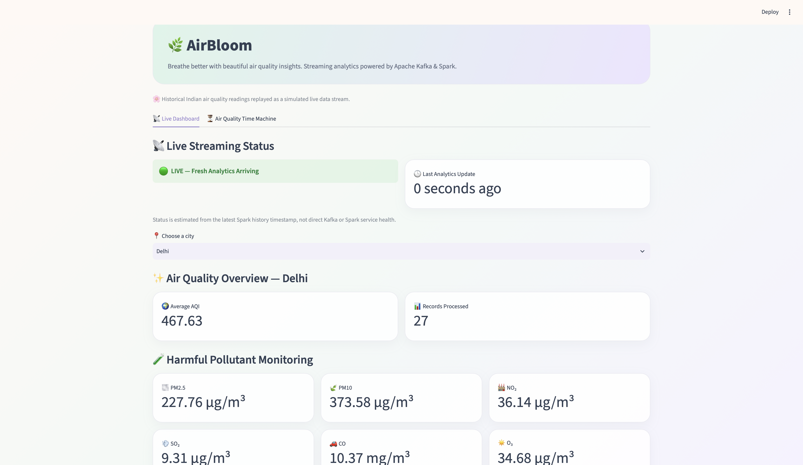
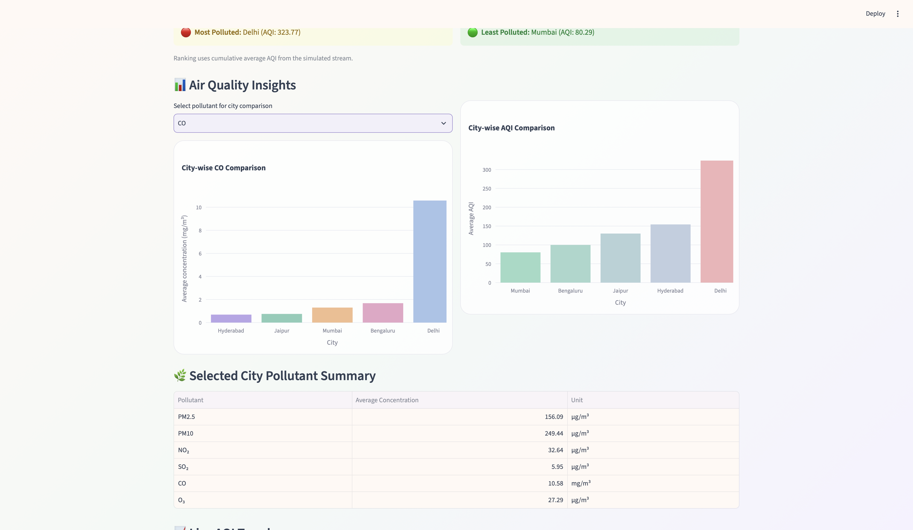
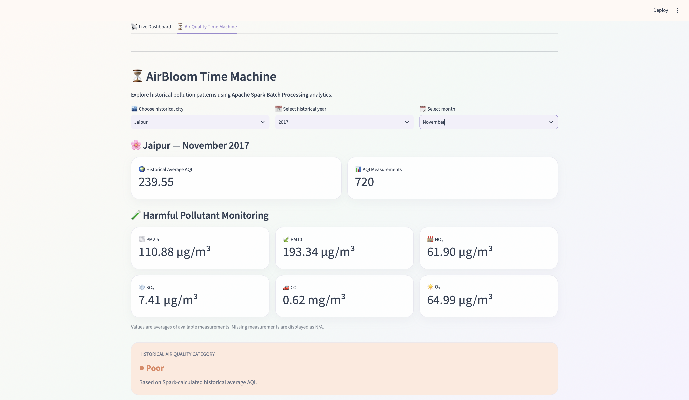
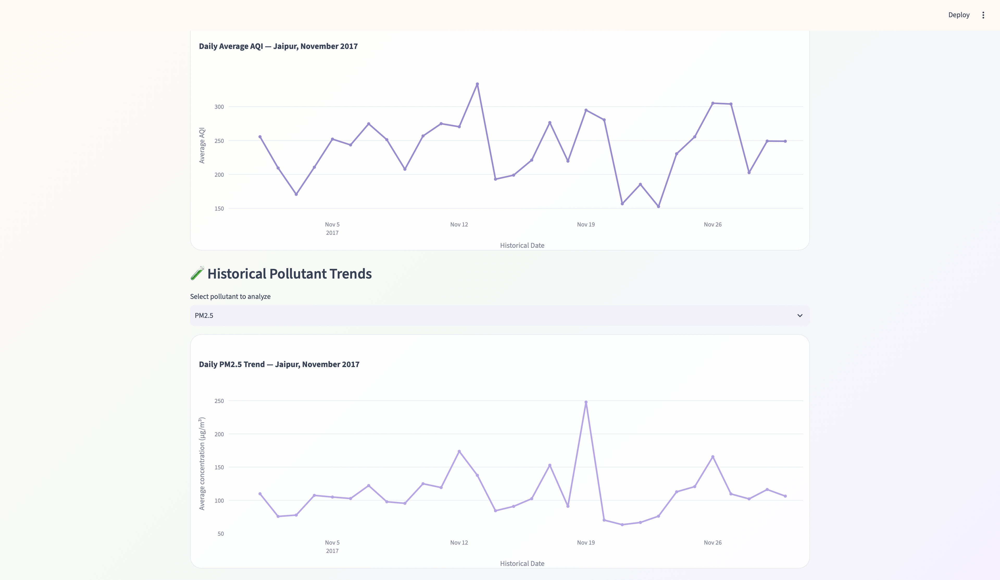

# 🌿 AirBloom — Smart Real-Time Air Quality Monitoring System

**A real-time air quality monitoring and historical analytics system powered by Apache Kafka, Apache Spark, Python, Docker, and Streamlit.**

AirBloom simulates real-time air quality readings using a historical Indian air quality dataset. It processes incoming data through a Kafka–Spark streaming pipeline and provides interactive air quality insights through a Streamlit dashboard.

The system also includes an **Air Quality Time Machine**, which uses Apache Spark Batch Processing to explore historical pollution trends.

## 📌 Project Overview

Air pollution is a major environmental concern in urban areas. AirBloom demonstrates how big data technologies, real-time data streaming, and analytics can be combined to monitor and analyze air quality across multiple Indian cities.

The project has two major components:

1. **Live Air Quality Dashboard:** Displays continuously updated AQI and pollutant analytics from a simulated real-time stream.
2. **Air Quality Time Machine:** Provides historical air quality analysis by city, year, and month.

**Note:** The system replays historical air quality measurements to simulate live sensor readings. It does not currently connect to physical IoT sensors or a live government API.

## 🎯 Objectives

- Simulate real-time air quality data streaming using Apache Kafka.
- Process streaming data using Apache Spark Structured Streaming.
- Monitor AQI and six major air pollutants.
- Compare air quality across multiple Indian cities.
- Classify AQI into pollution categories.
- Generate pollution alerts and general health recommendations.
- Analyze historical pollution trends using Spark Batch Processing.
- Visualize real-time and historical analytics through an interactive dashboard.

## 🛠️ Technologies Used

| Technology | Purpose |
|---|---|
| Python | Data preprocessing, Kafka Producer, and application development |
| Apache Kafka | Real-time message streaming |
| Apache Spark Structured Streaming | Processing incoming Kafka records |
| Apache Spark Batch Processing | Historical daily, monthly, and yearly analytics |
| Docker | Containerized Kafka and Spark environment |
| Streamlit | Interactive web dashboard |
| Pandas | Data loading, manipulation, and visualization preparation |
| Plotly | Interactive charts and graphs |
| CSV | Historical datasets and processed analytics storage |
| Git & GitHub | Version control and collaboration |

## 🏗️ System Architecture

AirBloom follows two data processing pipelines.

### 1. Real-Time Streaming Pipeline

```text
Historical Air Quality Dataset
             |
             v
     Data Preprocessing
             |
             v
      Python Kafka Producer
             |
             v
        Apache Kafka
     (air_quality_data)
             |
             v
   Spark Structured Streaming
             |
             v
    City-wise AQI and
    Pollutant Aggregation
             |
             v
      Processed CSV Files
             |
             v
    Streamlit Live Dashboard
```

### 2. Historical Batch Processing Pipeline

```text
Historical Air Quality Dataset
             |
             v
    Apache Spark Batch
        Processing
             |
             v
     Date Conversion and
    Numeric Data Processing
             |
             v
      Historical Analytics
       /      |       \
      v       v        v
    Daily   Monthly   Yearly
      \       |        /
       \      |       /
        v     v      v
      Processed CSV Files
             |
             v
    Air Quality Time Machine
             |
             v
      Historical Trends
     and Year Comparisons
```

Docker provides the containerized environment for Apache Kafka and Apache Spark.

## 🌆 Cities Monitored

- Delhi
- Mumbai
- Bengaluru
- Hyderabad
- Jaipur

## 🧪 Air Pollutants Monitored

AirBloom monitors six pollutants:

| Pollutant | Description |
|---|---|
| PM2.5 | Fine particulate matter |
| PM10 | Coarse particulate matter |
| NO₂ | Nitrogen dioxide |
| SO₂ | Sulfur dioxide |
| CO | Carbon monoxide |
| O₃ | Ground-level ozone |

The dashboard also displays the **Air Quality Index (AQI)** to summarize overall air quality.

## ✨ Key Features

### 📡 Live Air Quality Dashboard

- Simulated real-time air quality streaming.
- Automatic dashboard refresh every 5 seconds.
- City-wise average AQI monitoring.
- Monitoring of six pollutants.
- AQI classification into six categories.
- Pollution alerts based on AQI.
- General health recommendations.
- City pollution rankings.
- City-wise AQI comparison charts.
- Pollutant concentration comparison charts.
- Streaming AQI trend visualization.
- Live, delayed, or stale analytics status.
- Records processed counter.
- Interactive processed data tables.

### ⏳ Air Quality Time Machine

- Historical air quality analysis using Apache Spark Batch Processing.
- Selection of city, year, and month.
- Historical average AQI and pollutant statistics.
- Daily AQI trend visualization.
- Historical pollutant concentration trends.
- Monthly AQI pattern analysis.
- Year-to-year AQI comparison.
- Historical processed data tables.


## 📸 Dashboard Screenshots

### 🌿 Live Air Quality Dashboard


### 📊 Pollutant Analysis


### ⏳ Air Quality Time Machine


### 📈 Historical Pollution Trends



## 📂 Project Structure

```text
mini_project_dasss/
│
├── city_hour.csv
├── city_hour_cleaned.csv
├── data_cleaning.py
├── kafka_producer.py
├── dashboard.py
├── docker-compose.yml
│
├── spark/
│   ├── spark_streaming.py
│   └── spark_batch.py
│
├── output/
│   ├── air_quality_analytics.csv
│   │
│   ├── history/
│   │   └── aqi_history.csv
│   │
│   └── time_machine/
│       ├── daily_air_quality.csv
│       ├── monthly_air_quality.csv
│       └── yearly_air_quality.csv
│
├── .gitignore
└── README.md
```

**Note:** The historical datasets, Python virtual environment, and generated `output/` files are excluded from GitHub through `.gitignore`.

## 📊 Dataset

AirBloom uses the **Air Quality Data in India (2015–2020)** dataset available on Kaggle.

**Dataset Source:** [Air Quality Data in India — Kaggle](https://www.kaggle.com/datasets/rohanrao/air-quality-data-in-india)

The dataset contains historical air quality measurements including:

- City
- Date and time
- PM2.5
- PM10
- NO₂
- SO₂
- CO
- O₃
- AQI
- AQI category

The historical dataset is preprocessed before being used in the streaming and batch processing pipelines.

## 🚀 How to Run the Project

### Step 1 — Clone the Repository

```bash
git clone https://github.com/riyadeshmukh26/Smart-Real-Time-Air-Quality-Monitoring-System.git
cd Smart-Real-Time-Air-Quality-Monitoring-System
```

### Step 2 — Create a Python Virtual Environment

```bash
python3 -m venv .venv
source .venv/bin/activate
```

For Windows, the activation command differs.

### Step 3 — Install Python Dependencies

```bash
pip install pandas streamlit plotly kafka-python
```

### Step 4 — Prepare the Dataset

Download `city_hour.csv` from the dataset source and place it in the project root directory.

Run:

```bash
python data_cleaning.py
```

This generates:

```text
city_hour_cleaned.csv
```

### Step 5 — Start Docker Containers

Ensure Docker Desktop is running.

```bash
docker compose up -d
```

Verify the containers:

```bash
docker ps
```

### Step 6 — Create the Kafka Topic

```bash
docker exec kafka /opt/kafka/bin/kafka-topics.sh \
  --create \
  --if-not-exists \
  --topic air_quality_data \
  --bootstrap-server localhost:9092 \
  --partitions 1 \
  --replication-factor 1
```

### Step 7 — Create Output Directories

```bash
mkdir -p output/history output/time_machine
```

### Step 8 — Run Spark Batch Processing

Generate historical daily, monthly, and yearly analytics:

```bash
docker exec -it spark \
  /opt/spark/bin/spark-submit \
  --master "local[2]" \
  /opt/spark-apps/spark_batch.py
```

The generated files are stored in:

```text
output/time_machine/
```

### Step 9 — Start Spark Structured Streaming

Open another terminal and run:

```bash
docker exec -it spark \
  /opt/spark/bin/spark-submit \
  --master "local[2]" \
  --packages org.apache.spark:spark-sql-kafka-0-10_2.13:4.0.1 \
  /opt/spark-apps/spark_streaming.py
```

Spark starts consuming incoming Kafka messages and calculates city-wise analytics.

### Step 10 — Start the Kafka Producer

Open another terminal:

```bash
source .venv/bin/activate
python kafka_producer.py
```

The producer replays historical air quality readings to Kafka approximately every two seconds.

### Step 11 — Launch the Streamlit Dashboard

Open another terminal:

```bash
source .venv/bin/activate
streamlit run dashboard.py
```

Open the dashboard at:

http://localhost:8501

Explore both the **Live Dashboard** and **Air Quality Time Machine** tabs.

## 📈 AQI Categories

| AQI Range | Category |
|---|---|
| 0–50 | Good |
| 51–100 | Satisfactory |
| 101–200 | Moderate |
| 201–300 | Poor |
| 301–400 | Very Poor |
| Above 400 | Severe |

The AQI categories are used to display pollution classifications, alerts, and general health recommendations.

## 🧹 Data Cleaning and Processing

The project includes data preparation and processing at multiple stages.

**Data Preprocessing**

- Preparing the historical dataset.
- Handling missing and invalid values.
- Preparing timestamps and numeric pollutant readings.

**Kafka Producer**

- Selecting supported cities.
- Preparing historical records for simulated streaming.
- Adding streaming timestamps.

**Spark Structured Streaming**

- Reading Kafka messages.
- Parsing JSON records.
- Converting pollutant values to numeric types.
- Calculating city-wise average AQI and pollutant concentrations.
- Writing aggregated results to CSV.

**Spark Batch Processing**

- Reading the historical dataset.
- Converting date and numeric columns.
- Grouping records by city and time period.
- Calculating daily, monthly, and yearly averages.

## 💾 Data Storage

The project uses CSV-based storage for processed analytics rather than a traditional database.

| File | Purpose |
|---|---|
| `city_hour.csv` | Original historical dataset |
| `city_hour_cleaned.csv` | Cleaned historical dataset |
| `output/air_quality_analytics.csv` | Latest city-wise streaming aggregates |
| `output/history/aqi_history.csv` | Timestamped streaming AQI history |
| `output/time_machine/daily_air_quality.csv` | Daily historical analytics |
| `output/time_machine/monthly_air_quality.csv` | Monthly historical analytics |
| `output/time_machine/yearly_air_quality.csv` | Yearly historical analytics |

Apache Kafka manages streaming messages, while Spark processes records and generates analytics.

## ⚠️ Important Note

AirBloom is an educational prototype.

- Historical air quality readings are replayed as simulated real-time data.
- The system does not currently use physical IoT sensors.
- Displayed streaming AQI values are averages of processed historical records.
- Streaming timestamps represent when data was processed, not when the original environmental measurements were collected.
- The dashboard must not be used as a source of current real-world air quality conditions or official health warnings.

## 🔮 Future Enhancements

- Integration with real IoT air quality sensors.
- Live government or third-party air quality API integration.
- Database integration for long-term data storage.
- Predictive AQI forecasting using machine learning.
- Downloadable historical reports.
- Advanced geographical air quality visualization.
- Automated notification delivery for real-world pollution alerts.

## 👩‍💻 Collaboration

This project is developed collaboratively using Git and GitHub.

Contributors can create branches, implement features, and submit pull requests for review.

## 📄 Project Status

**Functional Prototype — Core Features Implemented**

- Kafka-based simulated real-time streaming.
- Spark Structured Streaming analytics.
- Spark Batch Processing analytics.
- Six-pollutant monitoring.
- Streamlit Live Dashboard.
- Air Quality Time Machine.
- AQI classifications, alerts, and health recommendations.

---

**🌿 AirBloom — Turning Air Quality Data into Meaningful Insights.**